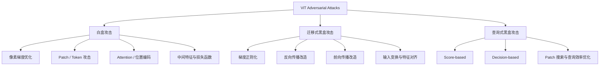
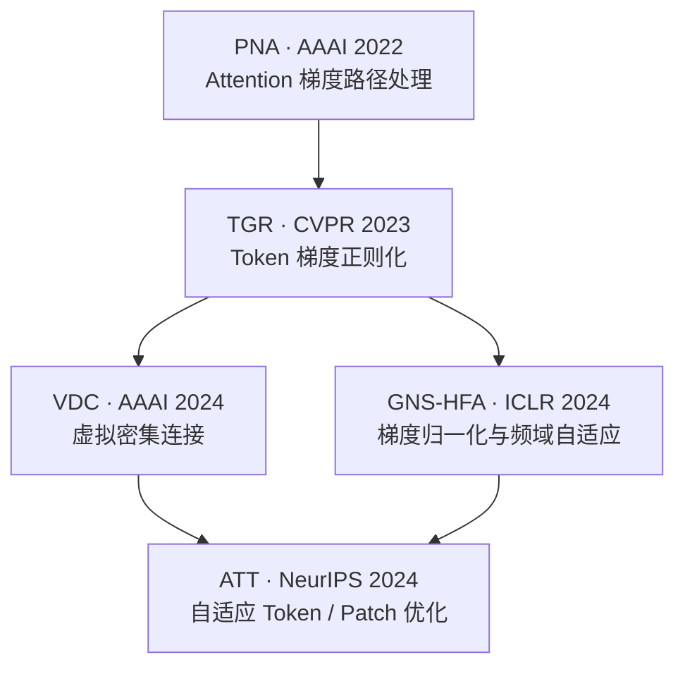

[[首页|首页]] · [[30_对抗机器学习/ViT与基础模型攻击/索引 - ViT与基础模型攻击|ViT与基础模型攻击索引]]

# ViT Attack - 文献综述与分类

# Vision Transformer 对抗攻击（ViT Attack）领域文献综述与研究脉络

> **文献梳理范围**：2020—2026 年 10 月  
> **研究重点**：对抗样本生成、攻击迁移性、ViT 结构特性与关键开创性工作  
> **说明**：本文将 ViT Attack 作为 *Vision Transformer 对抗攻击* 研究领域讨论，而不是仅指某一篇同名论文。论文“首创性”的表述按具体研究问题区分，并非经过全面引文考证后认定的绝对首篇。

ViT Attack 领域的研究可以沿一条比较清晰的主线理解：

**从“ViT 是否容易受到对抗攻击”，发展到“如何利用 ViT 特有结构进行攻击”，再到“如何提高对抗样本在不同 ViT、CNN 乃至其他视觉模型之间的迁移能力”。**

建议同时建立两套分类体系：

1. **攻击范式分类**：白盒攻击、迁移式黑盒攻击、查询式黑盒攻击。
2. **技术创新分类**：Patch/Token 攻击、Attention 攻击、梯度优化、特征攻击、模型结构优化、输入变换、跨架构迁移、下游任务攻击等。

---

## 一、领域的奠基性、开创性与关键性工作

以下论文值得优先掌握。“开创性”主要依据研究问题、提出的具体机制及后续研究影响，不等同于引用量排名。

| 论文 | 年份 / 会议 | 关键地位 |
|---|---|---|
| *An Image is Worth 16x16 Words* | ICLR 2021 | ViT 基础架构，整个方向的模型起点 |
| *On the Robustness of Vision Transformers to Adversarial Examples* | ICCV 2021 | 早期 ViT 对抗鲁棒性系统研究，重要奠基论文 |
| *Towards Transferable Adversarial Attacks on Vision Transformers* | AAAI 2022 | ViT 专用迁移攻击的重要开创性工作，提出 PNA、PatchOut |
| *Adversarial Token Attacks on Vision Transformers* | 2021 年预印本 | 早期 Token / 块稀疏攻击代表作 |
| *Patch-Fool: Are Vision Transformers Always Robust Against Adversarial Perturbations?* | ICLR 2022 | Patch 级攻击的重要代表作 |
| *Transferable Adversarial Attacks on Vision Transformers with Token Gradient Regularization* | CVPR 2023 | ViT 内部梯度正则化方向的关键工作，提出 TGR |
| *Transferable Adversarial Attack for Both Vision Transformers and Convolutional Networks via Momentum Integrated Gradients* | ICCV 2023 | 跨 ViT/CNN 迁移与积分梯度路线的重要工作 |
| *Improving the Adversarial Transferability of Vision Transformers with Virtual Dense Connection* | AAAI 2024 | 通过反向传播路径改造提高迁移性的重要工作 |
| *Improving Adversarial Transferability on Vision Transformers via Forward Propagation Refinement* | CVPR 2025 | 从反向梯度优化扩展到前向传播优化的关键工作 |

其中有必要区分两个概念：

- Mahmood 等人的 ICCV 2021 工作（2021 年 3 月已有预印本）侧重 **ViT 对抗鲁棒性分析**。
- Wei 等人的 PNA/PatchOut 工作（2021 年 9 月已有预印本；2022 年 AAAI 正式发表）侧重 **ViT 专用迁移攻击算法**。

另外，Naseer 等人在 2021 年 6 月已有 *On Improving Adversarial Transferability of Vision Transformers* 的预印本，因此不能简单地将 PNA/PatchOut 称为最早的 ViT 迁移攻击论文。

---

## 二、ViT Attack 领域的分类框架

### 2.1 按攻击者拥有的信息分类

> 以上分类并不互斥。例如，PNA 是迁移式黑盒攻击，同时也是 Attention 相关的反向传播梯度改造；PatchOut 同属迁移攻击，但通过随机 Patch 子集控制优化过程。

### 2.2 按迁移场景与任务分类

| 迁移场景 | 研究问题 |
|---|---|
| ViT → ViT | 不同 ViT 结构之间的迁移 |
| ViT → CNN | Transformer 产生的对抗扰动能否迁移到 CNN |
| CNN → ViT | CNN 代理模型产生的扰动能否迁移到 ViT |
| ViT → 检测 / 分割 | 对分类骨干生成的攻击能否破坏下游视觉任务 |
| ViT → CLIP / VLM | 向视觉语言模型、视觉基础模型迁移 |
| 数字 → 物理攻击 | 数字空间扰动能否在现实环境中保持有效 |

**注意**：Patch 局部攻击与传统小扰动攻击不能直接按攻击成功率比较。前者可以集中修改少量空间区域，后者通常具有 $L_p$ 范数约束，威胁模型不同。

---

## 三、ViT Attack 的研究发展史

### 3.1 第一阶段：2020—2021 年——ViT 对抗鲁棒性问题的建立

研究者主要关心：

- ViT 在对抗样本面前是否比 CNN 更鲁棒？
- CNN 与 ViT 之间为什么可能存在较弱的对抗迁移性？
- Patch 划分与 Self-Attention 是否构成新的攻击面？

| 论文 | 最早版本 / 正式发表 | 主要贡献 |
|---|---|---|
| [An Image is Worth 16x16 Words](https://arxiv.org/abs/2010.11929) | 2020.10 / ICLR 2021 | ViT 基础架构 |
| [Understanding Robustness of Transformers for Image Classification](https://openaccess.thecvf.com/content/ICCV2021/html/Bhojanapalli_Understanding_Robustness_of_Transformers_for_Image_Classification_ICCV_2021_paper.html) | 2021.03 / ICCV 2021 | 研究输入与模型扰动下的 Transformer 鲁棒性 |
| [On the Robustness of Vision Transformers to Adversarial Examples](https://arxiv.org/abs/2104.02610) | 2021.03 / ICCV 2021 | 白盒、黑盒及 CNN–ViT 迁移性研究 |
| [Reveal of Vision Transformers Robustness against Adversarial Attacks](https://arxiv.org/abs/2106.03734) | 2021.06 / 预印本 | 对多种 ViT 与混合架构进行攻击评估 |
| [Are Transformers More Robust Than CNNs?](https://proceedings.neurips.cc/paper/2021/hash/e19347e1c3ca0c0b97de5fb3b690855a-Abstract.html) | NeurIPS 2021 | 考虑公平训练设置重新比较 CNN / ViT 鲁棒性 |

特别推荐 *Are Transformers More Robust Than CNNs?*：研究提醒我们，对抗鲁棒性结论会受到模型规模、训练设置等因素影响，不能从结构差异直接推导 ViT 必然更鲁棒。

### 3.2 第二阶段：2021—2022 年——ViT 专用攻击方法涌现

按照代表性工作的预印本或会议发表时间排列：

| 时间 | 工作 | 核心贡献 | 路线定位 |
|---|---|---|---|
| 2021.06 / ICLR 2022 | [On Improving Adversarial Transferability of Vision Transformers](https://arxiv.org/abs/2106.04169)（Naseer et al.） | Self-Ensemble + Token Refinement；利用多个深度的 Class Token | 中间层表征与单模型自集成迁移攻击 |
| 2021.09 / AAAI 2022 | [Towards Transferable Adversarial Attacks on Vision Transformers](https://arxiv.org/abs/2109.04176)（Wei et al.） | PNA + PatchOut；Attention 梯度处理和 Patch 子集优化 | ViT 结构专用迁移攻击 |
| 2021.10 / 预印本 | [Adversarial Token Attacks on Vision Transformers](https://arxiv.org/abs/2110.04337)（Joshi et al.） | 块稀疏 Token 攻击 | Token / Patch 局部攻击 |
| 2021.11 / ECCV 2022 | [Are Vision Transformers Robust to Patch Perturbations?](https://arxiv.org/abs/2111.10659)（Gu et al.） | 分析注意力在自然与对抗 Patch 扰动下的表现 | Patch 鲁棒性分析 |
| 2021.12 / NeurIPS 2022 | [Decision-Based Black-Box Attack Against Vision Transformers via Patch-Wise Adversarial Removal](https://papers.neurips.cc/paper_files/paper/2022/hash/544696ef4847c903376ed6ec58f3a703-Abstract-Conference.html)（Shi et al.） | PAR；粗到细 Patch 搜索与噪声移除 | 决策式黑盒查询攻击 |
| 2022.03 / ICLR 2022 | [Patch-Fool: Are Vision Transformers Always Robust Against Adversarial Perturbations?](https://arxiv.org/abs/2203.08392)（Fu et al.） | 局部 Patch 修改与注意力干扰 | ViT Patch 对抗攻击 |

**重要区分**：

1. **Patch 局部攻击**：在一个或少量空间区域内集中修改图像，例如 Patch-Fool。
2. **Patch 采样式迁移攻击**：在优化迭代中随机选择 Patch 子集，例如 PatchOut。

两者名称相近，但研究目标、约束和机制不同。

### 3.3 第三阶段：2023—2024 年——迁移攻击精细化

研究问题集中于：

- 如何减少对代理模型的过拟合？
- 如何获得更稳定、更普适的中间层梯度？
- 如何让 ViT 生成的扰动迁移到 CNN？
- 如何联合梯度、频域、表示与传播路径的信息？

形成了 TGR、MIG、VDC、GNS-HFA、ATT 等具有代表性的技术路线。

### 3.4 第四阶段：2025 年及以后——前向结构、模型集成、自监督与跨任务迁移

研究关注点逐渐从输入梯度扩展到：

- Attention Map 与 Token Embedding 的前向改造；
- 单模型多层级表征与多模型代理集成；
- 自监督视觉特征（如 DINO / MAE）；
- 视觉基础模型及其下游任务。

---

## 四、按技术路线梳理关键论文

### 4.1 基于 Patch / Token 的攻击

**核心思想**：利用 ViT 的 Patch Token 结构，在局部图像空间或 Token 表征上设计攻击。

| 方法 | 论文 / 年份 | 核心创新 |
|---|---|---|
| Adversarial Token Attack | Joshi et al., 2021 | 块稀疏 Token 扰动 |
| Patch-Fool | Fu et al., ICLR 2022 | 局部 Patch 修改与注意力干扰 |
| Patch Perturbation | Gu et al., ECCV 2022 | Patch 对抗敏感性分析 |
| PatchOut | Wei et al., AAAI 2022 | 随机选择 Patch 子集优化，提高迁移性 |
| PAR | Shi et al., NeurIPS 2022 | 决策式黑盒 Patch 噪声移除与搜索 |
| ATT | Ming et al., NeurIPS 2024 | 自适应 Token 调整与渐进式 PatchOut |

### 4.2 基于 Attention / Embedding 的攻击

| 方法 | 论文 / 年份 | 核心创新 |
|---|---|---|
| PNA | AAAI 2022 | 处理注意力矩阵相关的反向梯度 |
| ATA | ACM MM 2022 | 联合攻击注意力不确定性和敏感 Embedding |
| GALD | *Multimedia Systems*, 2023 | 全局注意力引导与局部 Patch Drop |
| AAS | CVPR 2024 | 调整 Attention Softmax 缩放，改善梯度掩蔽问题 |
| FPR | CVPR 2025 | Attention Map Diversification 与 Momentum Token Embedding |

**ATA：Generating Transferable Adversarial Examples against Vision Transformers**  
ACM MM 2022；Architecture-oriented Transferable Attacking，利用 ViT 结构特点提升不同 ViT 间的攻击迁移。  
- [论文 DOI](https://doi.org/10.1145/3503161.3547989)
- [GitHub 代码](https://github.com/nlsde-safety-team/ATA)

**AAS：Towards Understanding and Improving Adversarial Robustness of Vision Transformers**  
CVPR 2024；指出 ViT 中 Attention Softmax 的数值问题可能造成梯度掩蔽，使常规攻击高估模型的鲁棒性，提出自适应注意力缩放。  
- [论文原文](https://openaccess.thecvf.com/content/CVPR2024/html/Jain_Towards_Understanding_and_Improving_Adversarial_Robustness_of_Vision_Transformers_CVPR_2024_paper.html)

**启示**：攻击成功率低不必然意味着模型鲁棒，也可能由梯度质量问题造成。

### 4.3 基于梯度优化与反向传播改造的迁移攻击

> 此图表示技术问题与研究机制的**概念性演进**，并不意味着各方法之间都存在直接引用或严格算法继承。

| 子方向 | 方法 | 研究对象 |
|---|---|---|
| 梯度截断 | PNA | Attention 梯度通路 |
| 梯度正则化 | TGR、GNS-HFA、ATT | Token、中间层与 Attention/MLP 梯度 |
| 梯度路径重构 | VDC | Transformer Block 之间的反向传播路径 |
| 积分梯度优化 | MIG | 图像积分梯度与迭代动量 |

论文链接：

- [TGR — CVPR 2023](https://openaccess.thecvf.com/content/CVPR2023/html/Zhang_Transferable_Adversarial_Attacks_on_Vision_Transformers_With_Token_Gradient_Regularization_CVPR_2023_paper.html)
- [VDC — AAAI 2024](https://ojs.aaai.org/index.php/AAAI/article/view/28541)
- [GNS-HFA — ICLR 2024](https://proceedings.iclr.cc/paper_files/paper/2024/hash/e25198b6a75f74277ee3a2bd4165d9ef-Abstract-Conference.html)
- [ATT — NeurIPS 2024](https://papers.nips.cc/paper_files/paper/2024/hash/24f8dd1b8f154f1ee0d7a59e368eccf3-Abstract-Conference.html)
- [MIG — ICCV 2023](https://openaccess.thecvf.com/content/ICCV2023/html/Ma_Transferable_Adversarial_Attack_for_Both_Vision_Transformers_and_Convolutional_Networks_ICCV_2023_paper.html)

### 4.4 基于前向传播与代理模型改造的攻击

**FPR：Improving Adversarial Transferability on Vision Transformers via Forward Propagation Refinement**  
Ren et al., CVPR 2025。

其主要机制包括：

- **AMD（Attention Map Diversification）**：注意力图多样化；
- **MTE（Momentum Token Embedding）**：Token Embedding 动量处理。

与主要从反向传播调整梯度的工作不同，FPR 将优化思路扩展到代理 ViT 的前向计算过程，提高扰动泛化性。

- [论文原文](https://openaccess.thecvf.com/content/CVPR2025/html/Ren_Improving_Adversarial_Transferability_on_Vision_Transformers_via_Forward_Propagation_Refinement_CVPR_2025_paper.html)
- [GitHub 代码](https://github.com/RYC-98/FPR)

注意：前向/反向改造并不完全互斥，因为修改前向计算也会改变最后计算出的输入梯度。

### 4.5 基于中间特征与表示学习的攻击

该路线不一定仅以分类标签损失为攻击目标，而可能直接扰动模型内部表征。

| 方法 | 年份 / 会议 | 核心思想 |
|---|---|---|
| Self-Ensemble + Token Refinement | ICLR 2022 | 利用多个深度的 Class Token 判别信息 |
| FDAP — Feature Diversity Adversarial Perturbation | AAAI 2024 | 无标签特征攻击，研究 ViT 特征坍缩现象 |
| dSVA | ICCV 2025 | 结合自监督 ViT 的对比学习与掩码建模特征 |
| APFD — Attention-Preserving Feature Distortion | ECAI 2025 论文集，2026 年在线发表 | Attention 保持条件下的特征扰乱 |

**FDAP：Attacking Transformers with Feature Diversity Adversarial Perturbation**  
AAAI 2024，针对特征坍缩提出无需分类标签的特征攻击。  
- [论文原文](https://ojs.aaai.org/index.php/AAAI/article/view/27947)

**dSVA：Boosting Generative Adversarial Transferability with Self-supervised Vision Transformer Features**  
ICCV 2025，组合两种自监督特征：

- DINO 类对比学习特征，偏重结构表征；
- MAE 类掩码图像建模特征，包含局部纹理信息。

进一步利用生成器产生更具跨架构迁移性的对抗样本。

- [论文原文](https://openaccess.thecvf.com/content/ICCV2025/html/Wu_Boosting_Generative_Adversarial_Transferability_with_Self-supervised_Vision_Transformer_Features_ICCV_2025_paper.html)
- [GitHub 代码](https://github.com/spencerwooo/dSVA)

### 4.6 基于模型集成与跨架构迁移的攻击

**ViT-EnsembleAttack：Augmenting Ensemble Models for Stronger Adversarial Transferability in Vision Transformers**  
ICCV 2025。

针对 ViT 代理模型集成的主要增强策略包括：

- Multi-head Dropping；
- Attention Score Scaling；
- MLP Feature Mixing。

核心想法是利用多种代理模型或代理变体，提高扰动对未知目标模型的适应性。

- [论文原文](https://openaccess.thecvf.com/content/ICCV2025/html/Cao_ViT-EnsembleAttack_Augmenting_Ensemble_Models_for_Stronger_Adversarial_Transferability_in_Vision_ICCV_2025_paper.html)

### 4.7 查询式黑盒攻击与其他攻击目标

| 攻击类别 | 代表论文 | 意义 |
|---|---|---|
| 决策式黑盒攻击 | PAR，NeurIPS 2022 | 只依赖目标模型分类决策，通过 Patch 重要性优化查询 |
| 对抗计算开销攻击 | SlowFormer，CVPR 2024 | 不一定改变预测类别，而是增加高效 ViT 的计算开销或能耗 |

**SlowFormer** 说明 ViT Attack 的目标不限于分类错误，还可以研究计算资源、运行时延和能耗方面的攻击。

- [SlowFormer — CVPR 2024](https://openaccess.thecvf.com/content/CVPR2024/html/Navaneet_SlowFormer_Adversarial_Attack_on_Compute_and_Energy_Consumption_of_Efficient_CVPR_2024_paper.html)

---

## 五、最重要的攻击算法思想

### 5.1 通用攻击目标与迁移攻击设定

经典非定向对抗攻击可写成：

$$
\max_{\|\delta\|_\infty\leq\epsilon}
\mathcal L(f_\theta(x+\delta),y)
$$

其中：

- $x$：原始图像；
- $\delta$：对抗扰动；
- $\epsilon$：扰动预算；
- $f_\theta$：待攻击模型；
- $y$：真实标签；
- $\mathcal L$：用于攻击优化的损失函数。

迁移攻击使用代理模型 $f_s$ 生成扰动，却希望在未知目标模型 $f_t$ 上仍然有效。

### 5.2 PNA：为什么要抑制 Attention 的梯度？

ViT 自注意力的核心计算为：

$$
A=\operatorname{Softmax}\left(\frac{QK^\top}{\sqrt{d_k}}\right),
\qquad Z=AV
$$

其中 $Q,K,V$ 为 Query、Key、Value 表示，$d_k$ 为 Key 维度。

常规反向传播的梯度既会受到注意力矩阵 $A$ 变化的影响，也会受到 Value $V$ 变化的影响。

PNA 的出发点是：某些注意力梯度可能高度依赖当前代理模型，因此停止梯度通过特定 Attention 路径传播，可能得到更容易迁移的扰动。

**核心认识**：代理模型最敏感的梯度方向，不一定是多个模型共享的脆弱方向。

### 5.3 TGR：为什么要正则化中间 Token 梯度？

设第 $l$ 层 Token 表示为：

$$
H_l\in\mathbb R^{N\times d}
$$

其反向传播梯度为：

$$
G_l=\frac{\partial\mathcal L}{\partial H_l}
$$

若少量 Token 或通道拥有极端梯度，它们可能主导扰动优化，使攻击过度依赖代理模型特有的局部特征。

TGR 按 ViT 内部结构选择性抑制异常梯度，以减少中间层梯度波动与代理模型过拟合，从而提升迁移性。

**注意**：TGR 并非简单地按常数等比例缩小所有梯度，而是针对特定的 Token 和模块实施梯度处理。

### 5.4 FPR：为什么前向传播值得优化？

设 ViT 第 $l$ 层的计算为：

$$
H_{l+1}=F_l(H_l)
$$

早期迁移方法多聚焦反向传播的梯度路径；FPR 则通过注意力图多样化、Token Embedding 动量处理，在前向过程中影响代理模型的内部表示，继而改变攻击迭代中的优化信号。

三种方法关注的重点不同：

| 方法 | 关注对象 | 关键问题 |
|---|---|---|
| PNA | 梯度路径 | 哪些梯度不应过度依赖？ |
| TGR | 梯度分布 | 哪些极端梯度应当抑制？ |
| FPR | 前向表征 | 如何改善代理模型的内部表示？ |

---

## 六、哪些论文可以称为某一方向的“第一篇”？

下面给出更严谨的“开创性起点 / 早期代表”表述。

| 研究方向 | 可作为开创性起点的工作 | 判断 |
|---|---|---|
| ViT 对抗鲁棒性系统研究 | Bhojanapalli et al.、Mahmood et al.，ICCV 2021 | 两篇重要早期工作，不唯一指定第一 |
| ViT 内部 Class Token 的迁移攻击 | Naseer et al.，ICLR 2022（2021.06 预印本） | 早期代表性工作 |
| ViT 专用 Attention 梯度迁移攻击 | PNA，AAAI 2022 | 重要开创性方法 |
| ViT Token 块稀疏攻击 | Joshi et al.，2021 | 早期探索 |
| ViT 对抗 Patch 机制研究 | Gu et al.，ECCV 2022；Fu et al.，ICLR 2022 | 两条相关关键路线 |
| ViT 专用决策式黑盒 Patch 搜索 | PAR，NeurIPS 2022 | 重要早期代表 |
| ViT 架构导向 Attention / Embedding 迁移 | ATA，ACM MM 2022 | 关键代表 |
| ViT 中间 Token 梯度正则化 | TGR，CVPR 2023 | 代表性开创方法 |
| ViT 梯度路径重构 | VDC，AAAI 2024 | 关键方法 |
| ViT 梯度缩放与频域联合优化 | GNS-HFA，ICLR 2024 | 代表性方法 |
| ViT 前向传播精炼式迁移攻击 | FPR，CVPR 2025 | 明确提出该视角的重要论文 |
| ViT 专用集成代理模型增强 | ViT-EnsembleAttack，ICCV 2025 | 作者主张的早期专门化代表 |
| 自监督 ViT 双特征生成式迁移 | dSVA，ICCV 2025 | 新路线重要代表 |

> **学术写作提醒**：“首次提出具体命名机制”与“整个方向第一次出现”是不同命题。正式在论文中使用 *first*、*pioneer* 等措辞前，仍应针对相应方向追溯此前文献。

---

## 七、建议的文献阅读顺序

### 第一轮：建立问题认识

- [ ] Mahmood — ICCV 2021：ViT 的对抗鲁棒性
- [ ] Bhojanapalli — ICCV 2021：Transformer 的图像分类鲁棒性
- [ ] Naseer — ICLR 2022：Class Token / Self-Ensemble
- [ ] Wei / PNA-PatchOut — AAAI 2022：ViT 迁移攻击

### 第二轮：理解 ViT 特有攻击面

- [ ] Adversarial Token Attacks — 2021
- [ ] Patch-Fool — ICLR 2022
- [ ] PAR — NeurIPS 2022
- [ ] ATA — ACM MM 2022

### 第三轮：研究迁移攻击核心技术

- [ ] TGR — CVPR 2023
- [ ] MIG — ICCV 2023
- [ ] VDC — AAAI 2024
- [ ] GNS-HFA — ICLR 2024
- [ ] ATT — NeurIPS 2024

### 第四轮：拓展至较新的技术路线

- [ ] AAS — CVPR 2024
- [ ] FDAP — AAAI 2024
- [ ] FPR — CVPR 2025
- [ ] ViT-EnsembleAttack — ICCV 2025
- [ ] dSVA — ICCV 2025

此外，也应该补充 FGSM、PGD、MI-FGSM、DI²-FGSM 等非 ViT 专用基础攻击方法，以理解一阶梯度、投影迭代、动量与输入多样化机制。

---

## 八、值得关注的进一步研究方向

| 研究方向 | 已有基础 | 值得继续探索的问题 |
|---|---|---|
| 多粒度特征迁移攻击 | Naseer、TGR、FDAP、dSVA | 不同层级、空间尺度、语义粒度如何协同优化？ |
| Attention 与表示子空间联合攻击 | PNA、ATA、FPR | 如何发现跨模型共享的敏感方向，而非代理模型独有梯度？ |
| 跨架构迁移 | MIG、VDC、ATT、ViT-EnsembleAttack | 如何同时提高 ViT→ViT、ViT→CNN、ViT→视觉基础模型的迁移率？ |
| 任务无关的视觉骨干攻击 | FDAP、dSVA、SAM 相关工作 | 未知下游任务或微调数据时，如何攻击共享视觉表示？ |

跨任务攻击还可延伸阅读：

- [Attack-SAM: Towards Attacking Segment Anything Model With Adversarial Examples](https://arxiv.org/abs/2305.00866)，2023。
- [Transferable Adversarial Attacks on SAM and Its Downstream Models](https://arxiv.org/abs/2410.20197)，2024。
- [Attacking Attention of Foundation Models Disrupts Downstream Tasks](https://openaccess.thecvf.com/content/CVPR2025W/AdvML/html/Silva_Attacking_Attention_of_Foundation_Models_Disrupts_Downstream_Tasks_CVPRW_2025_paper.html)，CVPR Workshop 2025。

相比简单组合两个攻击模块，更有研究价值的课题是：

$$
\boxed{\text{多层级特征}+\text{跨架构共享子空间}+\text{迁移性优化}}
$$

例如：

1. 分析 ViT 不同层级的 Token 表示，寻找共享的对抗敏感特征。
2. 分析 ViT 与 CNN 表征中是否存在能够跨架构迁移的对抗敏感子空间。
3. 基于跨层一致性、跨模型一致性设计攻击目标或梯度优化方法。
4. 使用统一预算、模型预处理、代理/目标矩阵验证迁移率。

但“存在共享子空间”“共享子空间能提升迁移性”都属于需要验证的研究假设，不能作为既定事实。

建议实验至少报告白盒 ASR、黑盒迁移 ASR、扰动预算、计算开销、攻击时长和跨架构迁移矩阵；保持数据、预处理和攻击预算一致，避免不公平对比。

---

## 九、推荐综述

1. [Survey of Adversarial Sample Attacks for Vision Transformer](https://www.jsjkx.com/EN/10.11896/jsjkx.250600065)，2026，《计算机科学》。针对 ViT 对抗攻击进行分类，覆盖白盒、迁移黑盒、决策黑盒、模型结构、下游任务等方面。
2. [A Survey on Transferability of Adversarial Examples Across Deep Neural Networks](https://mlanthology.org/tmlr/2024/gu2024tmlr-survey/)，TMLR 2024。从深度神经网络整体的视角梳理对抗迁移性研究。

---

## 十、最终建议：最值得重点精读的六篇论文

如果重点研究 **ViT 迁移对抗攻击**，优先顺序可定为：

1. **Naseer — ICLR 2022**：Self-Ensemble 与 Token Refinement，理解中间层表征如何增强迁移性。
2. **Wei — AAAI 2022**：PNA + PatchOut，理解针对 ViT 结构设计攻击策略。
3. **Zhang — CVPR 2023**：TGR，理解中间 Token 梯度正则化。
4. **Zhang — AAAI 2024**：VDC，理解反向传播路径对迁移性的影响。
5. **Ming — NeurIPS 2024**：ATT，理解自适应梯度处理与 Patch 优化。
6. **Ren — CVPR 2025**：FPR，理解前向传播精炼与表征优化。

若目标是全面了解 ViT 安全而不仅是迁移攻击，再补充：

- Mahmood — ICCV 2021：ViT 对抗鲁棒性；
- Patch-Fool — ICLR 2022：局部 Patch 攻击；
- PAR — NeurIPS 2022：决策式黑盒 Patch 攻击。

**整体主线**：

$$
\text{ViT 结构脆弱性}
\longrightarrow
\text{梯度优化}
\longrightarrow
\text{表征优化}
\longrightarrow
\text{跨模型迁移}
$$

---

*整理说明：本 Markdown 文件由当前对话中的前述综述整理生成，保留主要分类、论文链接、时间线、方法解释、公式与阅读清单；原回答的交互式界面已转换为 Markdown 表格、Mermaid 流程图与勾选框。*

---

## 笔记联系

- [[30_对抗机器学习/ViT与基础模型攻击/ViT Attack - 文献资料与研究问题|ViT Attack - 文献资料与研究问题]]：分类框架与文献资料互相补充；分别保留。
- [[30_对抗机器学习/ViT与基础模型攻击/ViT Attack - 发展历程|ViT Attack - 发展历程]]：分类框架与时间演进互相补充。
- [[30_对抗机器学习/迁移与特征攻击/论文 - Transferability in Machine Learning：From Phenomena to Black-Box Attacks using Adversarial Samples|论文 - Transferability in Machine Learning：From Phenomena to Black-Box Attacks using Adversarial Samples]]：补充跨模型攻击的迁移基础。
- [[30_对抗机器学习/ViT与基础模型攻击/SAM Attack - 分割基础模型攻击发展历程|SAM Attack - 分割基础模型攻击发展历程]]：对照分类模型与分割基础模型的攻击目标。
- [[30_对抗机器学习/ViT与基础模型攻击/VLM Attack - 视觉语言模型攻击发展历程|VLM Attack - 视觉语言模型攻击发展历程]]：对照纯视觉与视觉语言模型的攻击研究。
- [[30_对抗机器学习/领域总览/对抗攻击 - 方法与研究前景|对抗攻击 - 方法与研究前景]]：对照总体研究前景与 ViT 专题中的问题分类。
