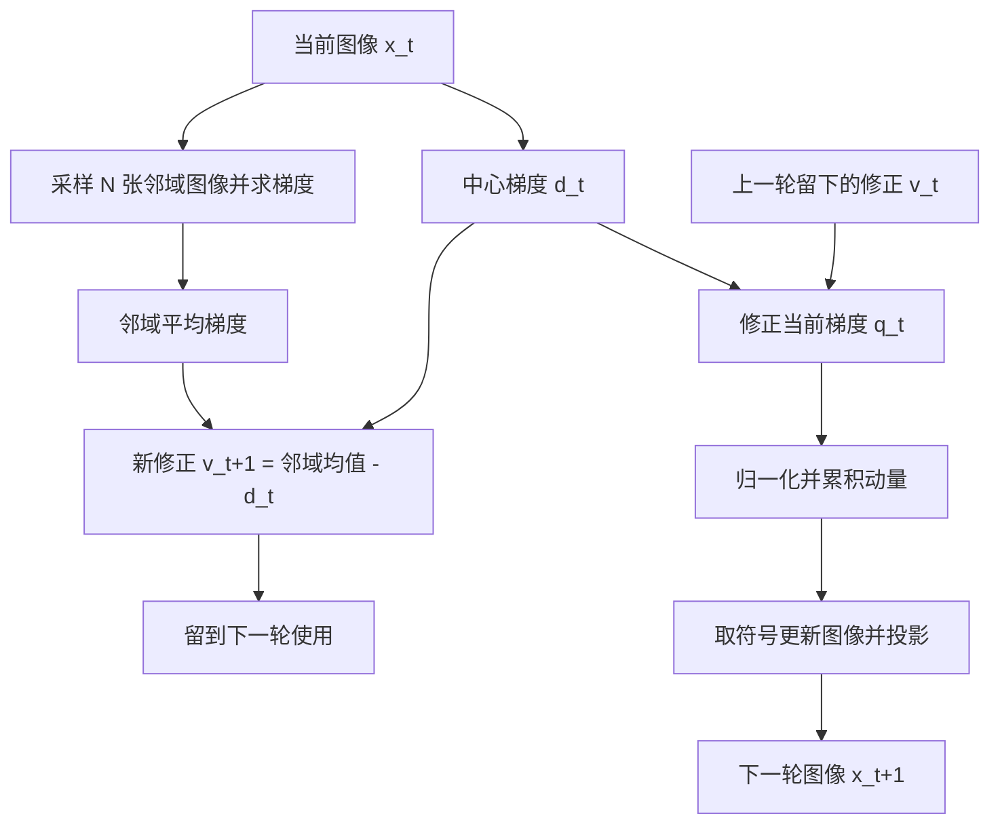

[[首页|首页]] · [[30_对抗机器学习/迁移与特征攻击/总结 - 迁移与特征攻击|迁移与特征攻击总结]]

# VMI：方差调节动量攻击详解

## 一、先抓住核心：用邻域信息修正梯度，再加入动量

**VMI-FGSM 在 MIM 的基础上增加了一个邻域梯度修正项：上一轮计算“邻域平均梯度减去中心梯度”，这一轮用它修正当前梯度，再归一化、累积动量并更新图像。**

三个关键词分别是：

- **邻域**：在当前图像附近添加小幅随机偏移，观察附近输入点的梯度。
- **修正**：用邻域均值与中心梯度的差，描述中心方向相对附近平均方向的偏移。
- **动量**：把修正后的方向继续与前几轮方向结合。

“Variance Tuning”是论文的方法名称。**其中的修正项不是统计学中通常使用的平方偏差方差，而是一个可正可负的向量。**

论文为 Xiaosen Wang、Kun He 的 *Enhancing the Transferability of Adversarial Attacks Through Variance Tuning*，CVPR 2021，1924–1933。

本次核对 CVF 正式发表记录、作者 arXiv v3 全文、官方 `vmi_fgsm.py` 及相关 VNI 实现；未运行攻击实验。下文统一公式记号，补充推导与数值例子为教学说明。已于 2026-11-08 按用户确认归档到“迁移与特征攻击”目录，并关联主题总结、MIM 笔记及 [[论文来源目录#vmi]]。

## 二、从 MIM 出发：历史方向之外，还能看哪里？

设原图为 $x$，当前对抗图为 $x_t$，真实标签为 $y$。源模型为 $f_s$，前向过程包含相应的预处理。定义：

$$
d_t=\nabla_{x_t}L(f_s(x_t),y).
$$

MIM 的典型形式为：

$$
m_{t+1}=\mu m_t+\frac{d_t}{\|d_t\|_1+\eta},
$$

$$
x_{t+1}=\Pi_{\mathcal C}
\left(x_t+\alpha\operatorname{sign}(m_{t+1})\right).
$$

$\eta$ 为防止除零的小常数，归一化按每张图像分别计算；$\mathcal C$ 为原图的扰动预算与合法像素范围。

MIM 会参考历史，但历史中的每一轮主要仍取自攻击轨迹上的那个输入点。VMI 进一步利用轨迹周围的输入点，减少对单点梯度的依赖。

需要区分两类“周围”：

- TIM 聚合的是同一张梯度图上的邻近像素位置。
- VMI 采样的是图像输入空间中的邻近图像，每张图都需要重新计算模型梯度。

## 三、邻域怎样构造？

在第 $t$ 轮，围绕当前图像 $x_t$ 采样：

$$
x_t^{(i)}=x_t+r_{t,i},\qquad i=1,\ldots,N.
$$

每个随机偏移张量的各坐标独立服从：

$$
(r_{t,i})_j\sim U(-\beta\epsilon,\;\beta\epsilon).
$$

- $N$：邻域样本数量。
- $\beta$：邻域半径相对攻击预算的倍率。
- $\epsilon$：与当前输入坐标一致的攻击预算。

这是一种高维立方邻域采样。它不要求把图像向左或向右移动，也不改变图像分辨率。

随机偏移只用于探测附近梯度，不直接作为最终攻击噪声输出。最终对抗图像仍由梯度方向优化得到。

## 四、“方差”究竟是什么？

### 4.1 实际计算的是均值差向量

邻域平均梯度为：

$$
\overline d_t=\frac1N\sum_{i=1}^{N}
\nabla_{x_t^{(i)}}L(f_s(x_t^{(i)}),y).
$$

定义本轮得到、下一轮使用的修正项：

$$
\boxed{v_{t+1}=\overline d_t-d_t}.
$$

若中心梯度已经接近附近平均方向，修正较小；若中心方向与附近均值不同，修正会把这种差别记录下来。

### 4.2 与通常的统计方差不同

通常的标量方差形如：

$$
\operatorname{Var}(Z)=\mathbb E[(Z-\mathbb EZ)^2],
$$

它含有平方，结果非负。对向量还可以讨论逐坐标方差或协方差矩阵。

VMI 的 $v$ 没有平方，形状与输入梯度相同，分量可以为正、负或零。所以应按“邻域均值相对中心梯度的偏移”理解，不能把统计方差直接加进算法。

### 4.3 一个说明差别的数学例子

考虑一维损失 $L(z)=z^2/2$，其梯度为 $L'(z)=z$。若邻域偏移 $r$ 对称且均值为零，则：

$$
\mathbb E[L'(z+r)]-L'(z)=\mathbb E[z+r]-z=0.
$$

但邻域梯度的统计方差为 $\operatorname{Var}(z+r)=\operatorname{Var}(r)$，通常大于零。

因此，“VMI 修正项为零”并不表示邻域内所有梯度完全相同。这个例子是对两种数学量的区分，不是原论文实验。

## 五、完整算法：修正项滞后一轮使用

### 5.1 更新公式

初始化：

$$
x_0=x,\qquad m_0=0,\qquad v_0=0.
$$

每轮先计算当前中心梯度 $d_t$，用已有修正项得到：

$$
q_t=d_t+v_t,
$$

$$
m_{t+1}=\mu m_t+
\frac{q_t}{\|q_t\|_1+\eta}.
$$

同时在当前 $x_t$ 的邻域采样，计算：

$$
v_{t+1}=\overline d_t-d_t.
$$

最后更新图像：

$$
x_{t+1}=\Pi_{\mathcal C(x,\epsilon)}
\left(x_t+\alpha\operatorname{sign}(m_{t+1})\right).
$$

**本轮更新使用 $v_t$，本轮新计算的 $v_{t+1}$ 留到下一轮使用。** 原文 Algorithm 1 和官方 VMI 实现都采用这一时间关系。

因此，第一轮因 $v_0=0$，更新方向与相同配置的 MIM 一致。第一轮仍会计算邻域信息，以供第二轮使用。

### 5.2 为何不等于直接使用本轮邻域均值？

对于 $t\ge1$：

$$
q_t=d_t+(\overline d_{t-1}-d_{t-1})
=\overline d_{t-1}+(d_t-d_{t-1}).
$$

可以把它理解为：**上一轮的邻域平均方向，加上中心梯度从上一轮到这一轮的变化量。**

若中心移动很小，邻域修正可能仍有参考价值；若变化很大，旧修正也可能过时。这是对公式的解释，不是保证。

若改成当轮立刻使用 $d_t+(\overline d_t-d_t)=\overline d_t$，就成为直接按当前邻域均值更新的变体，不能当作原始 VMI 的完全相同实现。

### 5.3 一个二维数值例子

假设上一轮：

$$
d_{t-1}=(2,-1),\qquad
\overline d_{t-1}=(0.5,0.5),
$$

于是：

$$
v_t=(-1.5,1.5).
$$

这一轮中心梯度为 $d_t=(1.8,-0.8)$，则：

$$
q_t=d_t+v_t=(0.3,0.7).
$$

进入动量前，第二个坐标的方向从负变为正。这个例子说明邻域修正可以改变方向；最终更新仍需结合历史动量。

## 六、用流程图看清时间关系



本轮邻域采样和当前方向计算可以在实现中组织得不同，但数据依赖必须保持：新修正不能意外覆盖本轮应使用的旧修正。

## 七、教学伪代码

下面按 $[0,1]$ 像素坐标写出非定向 VMI；模型前向包含所需预处理。这是教学结构，不是完整复现脚本。

```text
x_adv = 原图 x
momentum = 0
correction = 0
lower = max(x - ε, 0)
upper = min(x + ε, 1)

重复 T 轮：
    center_grad = 输入梯度(x_adv)
    tuned_grad = center_grad + correction
    next_momentum = μ * momentum + normalize_L1(tuned_grad)

    neighbor_grad_sum = 0
    重复 N 次：
        r = 均匀采样，与图像同形状，范围 [-βε, +βε]
        neighbor_grad_sum += 输入梯度(x_adv + r)
    next_correction = neighbor_grad_sum / N - center_grad

    x_adv = clip(x_adv + α * sign(next_momentum), lower, upper)
    momentum = next_momentum
    correction = next_correction

输出 x_adv
```

这里模型参数保持固定；采样在每轮重新进行。邻域探测点是否裁剪，应与采用的实现一致，不能默默改变定义。

## 八、为什么可能提高迁移性？

### 8.1 从单点方向扩展到附近输入的响应

若某个方向仅在源模型的一个精确输入点上特别有效，周围稍微变化后就不成立，它可能过度依赖源模型局部细节。邻域信息让攻击方向受到更多附近输入状态的影响，可能减少这种依赖。

但邻域梯度平稳不证明该方向就是跨模型共享的语义特征，也不保证对目标模型有效。

### 8.2 与平滑损失的联系

作为补充理解，定义平滑损失：

$$
L_{\mathrm{smooth}}(z)=\mathbb E_r[L(f_s(z+r),y)].
$$

在允许交换求导与期望的条件下：

$$
\nabla_zL_{\mathrm{smooth}}(z)
=\mathbb E_r[\nabla_zL(f_s(z+r),y)].
$$

邻域均值近似的是这种平滑损失的梯度。因此 $V(z)$ 可以理解为平滑方向与中心方向的差。不过原始 VMI 使用滞后一轮的差分，不能直接认定每一步都精确优化这个平滑损失。

### 8.3 “方差减少”的解释边界

固定模型、固定输入和确定性前向下，中心梯度本身是确定的；随机性来自邻域采样等环节。与随机优化中的方差缩减有动机联系，不代表它直接套用了 SVRG 的公式或继承了其收敛结论。

有限样本均值也有估计误差。邻域扩大可能提供更广的信息，也可能破坏有用的局部方向；更新不会被保证每轮更稳定或得到全局最优。

## 九、与 MIM、DIM、TIM、SIM、SGM 的区别

| 方法 | 核心改动 | 关注的维度 |
|---|---|---|
| MIM | 累积历史梯度方向 | 迭代历史 |
| DIM | 随机缩放尺寸与填充后求梯度 | 几何输入视图 |
| TIM | 对梯度作空间卷积 | 梯度图上的邻近位置 |
| SIM | 聚合多个数值幅度副本的梯度 | 输入幅度视图 |
| SGM | 调整残差分支的反向梯度贡献 | 网络反向传播路径 |
| VMI | 用上一轮邻域均值差修正当前梯度，再积累动量 | 输入空间邻域及迭代历史 |

VMI 可与输入变换组合。论文将 DIM、TIM、SIM 的组合称为 CTM，并报告 VMI-CT-FGSM、VNI-CT-FGSM 等结果。

组合时应明确中心梯度与邻域梯度各自使用哪些变换、随机视图是否重采样、先卷积还是先归一化。不能只把方法名连起来就默认得到某个固定算法。

### VMI 与 VNI

VMI 在 MI 的基础上增加方差调节；VNI 则与 Nesterov 前瞻机制结合。

如果进一步研究 VNI，需要额外核对前瞻点、邻域中心和差分基准。官方 `vni_fgsm.py` 中，中心梯度来自前瞻位置，而邻域采样函数以当前图像为中心，并减去该前瞻梯度；不能机械地把 VMI 公式中的所有点统一替换成前瞻点。本文完整公式与伪代码专指基本 VMI。

## 十、参数、预算与计算成本

### 10.1 论文基本设置

| 参数 | 设置 | 含义 |
|---|---:|---|
| 最大像素扰动 | 16/255 | 换算到 $[0,1]$ 的 $\ell_\infty$ 预算 |
| 外层轮数 T | 10 | 每张图像迭代次数 |
| 单步步长 | 1.6/255 | 与预算、轮数配套 |
| 动量系数 μ | 1 | 历史方向权重 |
| 邻域样本数 N | 20 | 每轮额外采样数量 |
| 邻域倍率 β | 1.5 | 每个坐标的采样半宽为 $1.5\epsilon$ |

这些是原论文及基本示例的设置，不是对所有架构都最优的参数。

### 10.2 βε 是探测半径，ε 是最终图像预算

当 $\beta=1.5$ 时，邻域探测点可以超出当前图像的 $\epsilon$ 邻域，也可能超出合法像素范围。官方基本 VMI 的邻域函数没有对这些探测点另行裁剪。

这不改变最终输出的预算：每次实际更新后，都投影回原图 $x$ 的 $\epsilon$ 邻域及合法像素范围。

若把邻域点裁剪到合法范围，采样分布会改变，尤其在边界附近；这可以是实现选择，但应明确说明。

### 10.3 额外梯度计算不可忽略

基本 VMI 每轮需要：

- 1 次中心梯度计算；
- N 次邻域梯度计算。

$N=20$ 时约为 21 份输入的前向、反向工作量。10 轮的直接实现约计算 210 份输入梯度，不能与 MIM 的 10 轮按相同计算量比较。

批处理可提高吞吐，顺序处理可减少显存压力；实际耗时不能机械地认定为固定 21 倍。最后一轮新修正不再用于输出方向，忠实原流程仍可能计算它。

### 10.4 退化设置

基本 VMI 在确定性模型下，若 $\beta=0$，邻域均值等于中心梯度，修正为零，退化为同配置的 MIM。

若想用 $N=0$ 关闭方差调节，应显式跳过采样并令修正为零。原公式有除以 N，不能直接把 0 代入而不处理。

## 十一、实验结果应该怎样看？

### 11.1 基本 VMI 的直接对照

原文表 1 以 Inc-v3 为源模型，报告：

| 方法 | Inc-v3 白盒 | Inc-v4 黑盒 | Inc-v3 ens3 黑盒 |
|---|---:|---:|---:|
| MI-FGSM | 100.0% | 43.6% | 13.1% |
| VMI-FGSM | 100.0% | 71.7% | 32.8% |

在这两个目标上分别增加 28.1 和 19.7 个百分点。这说明相近的源模型白盒成功率可以对应明显不同的迁移效果，不表示任何目标上都提高相同幅度。

论文将成功率定义为目标模型对对抗图像的误分类率。数据为 1000 张 ImageNet 验证图像，原文称它们几乎都被测试模型正确分类；不能改写成全部图像都经过“共同正确”的严格筛选。

### 11.2 90.1% 是更强组合的结果

原文表 4 的多模型集成设置，在九个防御目标上的平均值为：

| 方法 | 九个防御目标的平均误分类率 |
|---|---:|
| MI-CT-FGSM | 85.1% |
| VMI-CT-FGSM | 88.9% |
| NI-CT-FGSM | 83.5% |
| VNI-CT-FGSM | 90.1% |

CT 包含 DIM、TIM、SIM，集成源模型为四个普通训练模型。90.1% 属于 **VNI + 复合变换 + 多源模型集成**，不能当成基本 VMI 的成绩。

不同论文的样本、预算和源模型可能不同，不能把这里的数值直接与 DIM、TIM、SIM 原论文数值拼成统一排行榜。这些结果也不代表对当前全部防御的效果。

## 十二、官方实现核对与易错点

核对来源：[官方仓库](https://github.com/JHL-HUST/VT)、[vmi_fgsm.py](https://github.com/JHL-HUST/VT/blob/main/vmi_fgsm.py)、[vni_fgsm.py](https://github.com/JHL-HUST/VT/blob/main/vni_fgsm.py)。本次为静态阅读，未运行复现。

1. `current_grad = new_grad + variance` 使用传入的旧修正；随后才用邻域均值减中心梯度，生成下一轮修正。实现时必须保持该顺序的数据依赖。
2. 先把原始梯度与原始修正相加，再统一归一化。若先分别归一化，会改变相对权重。
3. 修正项每轮重新赋值，不是像动量一样不断累加；动量和修正是两个不同状态变量。
4. 示例用每张图像的平均绝对值归一化，正文记号为 L1 范数。对于基本 VMI，固定维度下的共同尺度不改变最终动量符号；若用于带前瞻的 VNI，归一化会影响探测点，需单独核对。
5. 示例将像素映射到 $[-1,1]$，预算、步长及邻域半径都按相应坐标换算。不能混用原始像素尺度与模型输入尺度。
6. 示例把第一轮源模型预测固定为攻击标签；本文教学公式使用真实标签。若二者不同，攻击过程与误分类评估需要区分。
7. 模型参数保持固定，但输入梯度仍需开启。邻域梯度来自源模型，生成攻击时不依赖目标模型查询。
8. 代码中定义输入变换函数或卷积核，不等于基本 `vmi_fgsm.py` 已启用这些环节；组合版本应看实际执行路径。

## 十三、快速复习与笔记联系

**VMI 比 MIM 多了什么？** 上一轮保存的邻域均值差修正。

**“方差”是平方偏差吗？** 不是，是邻域平均梯度减去中心梯度的向量。

**本轮邻域均值直接用于本轮更新吗？** 原始 VMI 不这样用；本轮新修正留到下一轮。

**是否直接给输出加随机噪声？** 不是。随机偏移用于探测梯度，输出由修正后的动量方向生成。

**会不会扩大最终像素预算？** 不会，最终图像和每轮实际更新仍受原图预算投影约束。

**主要代价是什么？** 每轮额外计算 N 次邻域梯度。

- [[30_对抗机器学习/攻击方法/MIM - 动量迭代攻击详解]]：理解“修正后再累积”的动量更新，以及两个状态变量的区别。
- [[30_对抗机器学习/迁移与特征攻击/DIM - 输入多样性攻击详解]]：比较随机几何视图与随机邻域探测图像。
- [[30_对抗机器学习/迁移与特征攻击/TIM - 平移不变攻击详解]]：区分像素空间位置聚合和输入空间邻域聚合。
- [[30_对抗机器学习/迁移与特征攻击/SIM - 尺度不变攻击详解]]：比较幅度副本与加性邻域副本，以及 NI 前瞻扩展。
- [[30_对抗机器学习/迁移与特征攻击/SGM - 跳跃梯度方法]]：区分调整反向路径与调整输入梯度估计。
- [[10_基础与算法/数学基础/噪声 - 随机噪声与对抗扰动详解]]：理解采样分布、随机探测和最终对抗扰动的区别。
- [[30_对抗机器学习/领域总览/Threat Model - 威胁模型详解]]：理解源模型白盒、目标模型迁移黑盒以及评估口径。

## 来源

1. Wang and He, CVPR 2021：[CVF 正式发表记录](https://openaccess.thecvf.com/content/CVPR2021/html/Wang_Enhancing_the_Transferability_of_Adversarial_Attacks_Through_Variance_Tuning_CVPR_2021_paper.html)。
2. [作者 arXiv 记录](https://arxiv.org/abs/2103.15571)、[可读全文](https://arxiv.org/html/2103.15571)，本次对应 v3。方法核对 Algorithm 1、第 3.2 节；参数及统计口径核对第 4 节与表 1/4。
3. [官方实现](https://github.com/JHL-HUST/VT)，用于核对旧修正与新修正、邻域采样位置、坐标范围和动量更新。
